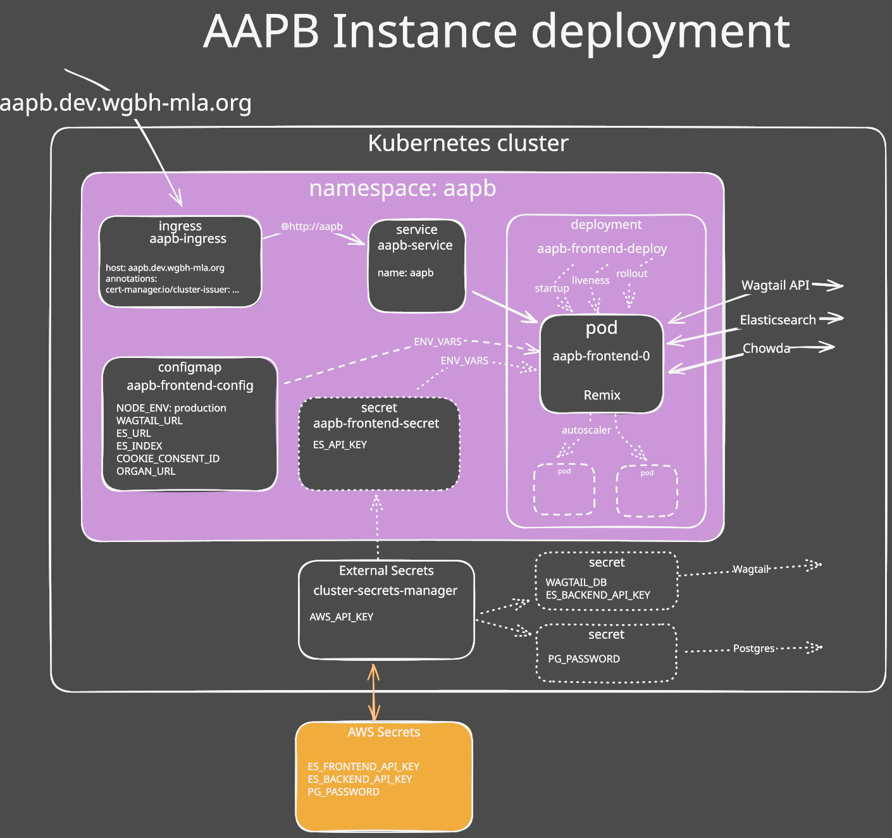
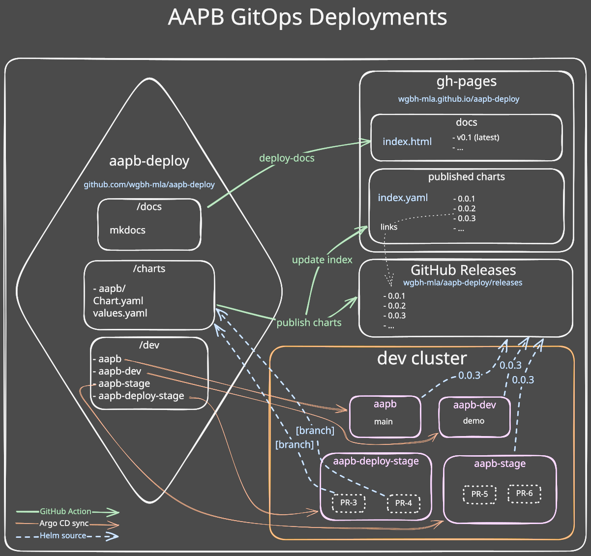
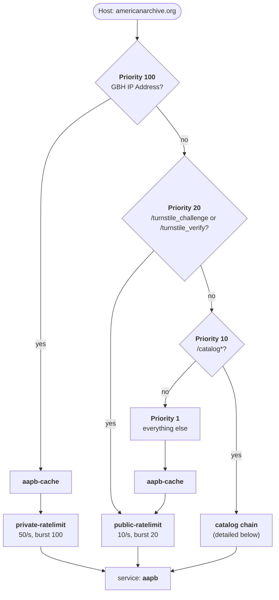
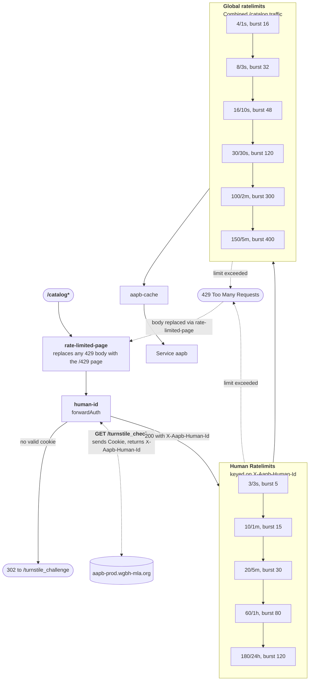

# Architecture

This section provides a high-level overview of the architecture of the AAPB application, including its components and how they interact with each other.

## Deployment

The AAPB application is deployed on a Kubernetes cluster using Helm charts for package management and Argo CD for continuous deployment.

The following diagram illustrates the kubernetes architecture of a single AAPB instance:

For installation instructions, see the [Quickstart Guide](../tutorials/quickstart.md).

## GitOps
Deployments are managed using a GitOps strategy, with Argo CD Applications.

The following diagram illustrates the GitOps architecture of the [aapb-deploy repository](https://github.com/WGBH-MLA/aapb-deploy/):

## Production Ingress

Production traffic for `americanarchive.org` enters through a Traefik `IngressRoute` ([production/ingressroute.yaml](https://github.com/WGBH-MLA/aapb-deploy/blob/main/production/ingressroute.yaml)). The router with the highest `priority` that matches a request wins, and each router runs its own middleware chain before forwarding to the `aapb` Service, an `ExternalName` for `aapb-prod.wgbh-mla.org:443`.

### Route selection

The priority 20 route has no `human-id` middleware. The Turnstile challenge and its static assets must stay reachable without a verified cookie, or visitors would be redirected in a loop.

### `/catalog` middleware chain

Middlewares run top to bottom. `human-id` runs before `aapb-cache` so that the challenge redirect is never cached.

### Where things are defined

| Resource | File |
|---|---|
| `IngressRoute` | [production/ingressroute.yaml](https://github.com/WGBH-MLA/aapb-deploy/blob/main/production/ingressroute.yaml) |
| `rate-limited-page`, `human-id`, `human-id-ratelimit-*` | [production/human-ratelimits.yaml](https://github.com/WGBH-MLA/aapb-deploy/blob/main/production/human-ratelimits.yaml) |
| `private-ratelimit`, `public-ratelimit`, `global-ratelimit-*` | [production/site-ratelimits.yaml](https://github.com/WGBH-MLA/aapb-deploy/blob/main/production/site-ratelimits.yaml) |
| `aapb-cache` | Defined in the cluster only, not in this repository |
